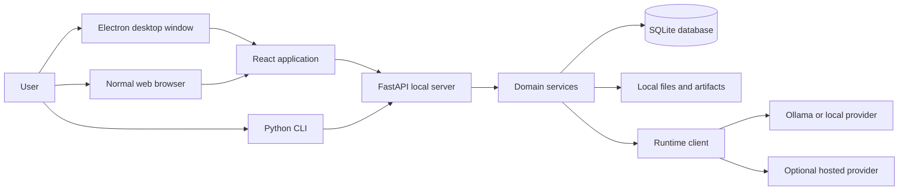
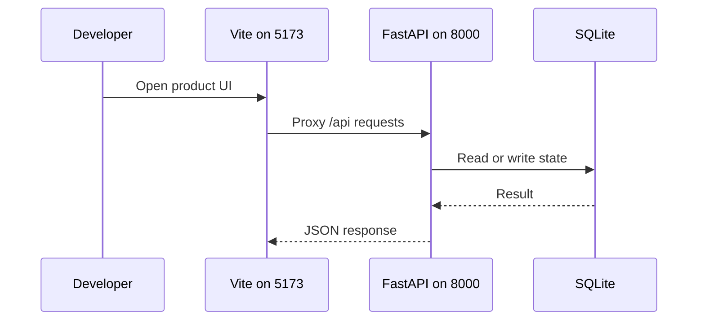
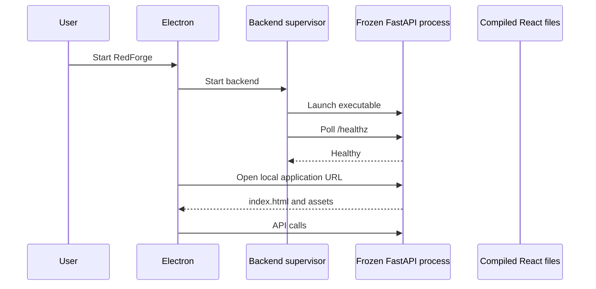
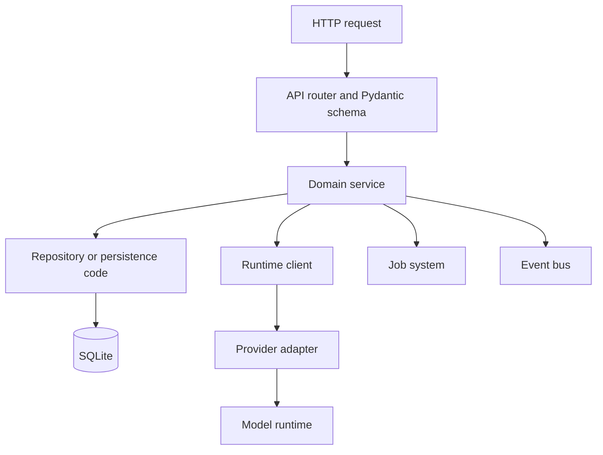
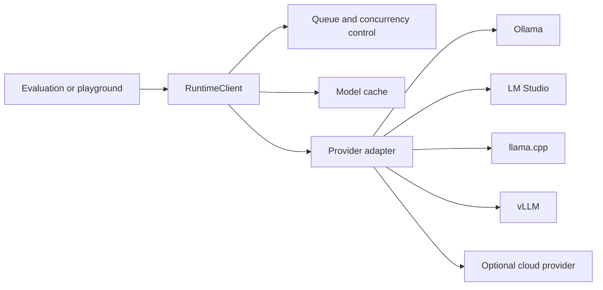
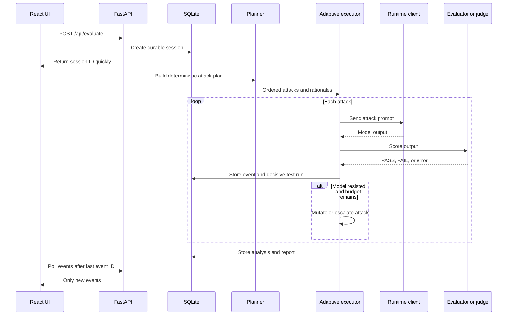
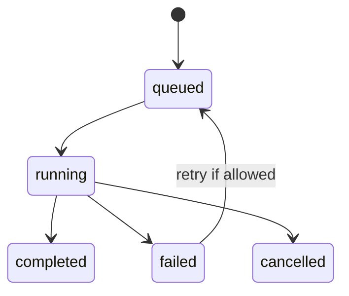
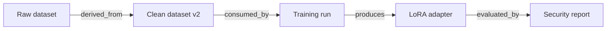
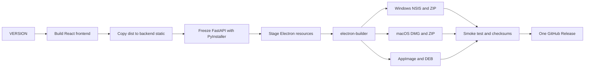

# RedForge: Complete Beginner and Interview Study Guide

This guide explains the RedForge repository as it exists on October 12, 2026. It is written for someone starting from zero. Read it in order the first time. Later, use the interview sections for revision.

## 1. The one-minute explanation

RedForge is a local-first desktop workbench for building and testing AI systems.

Instead of using a separate tool for models, datasets, training, benchmarks, security tests, reports, and experiment history, RedForge puts those jobs in one application. The main work happens on the user's computer. Cloud model providers are optional.

The simple architecture is:



The short interview pitch is:

> RedForge is a local-first desktop workbench for the full LLM engineering lifecycle. It combines model discovery, datasets, LoRA or QLoRA training, benchmarks, adversarial evaluation, reports, artifacts, and experiment history. A React interface talks to a local FastAPI server. SQLite stores durable state. Electron packages the system as a desktop application. A provider abstraction lets the same workflow use Ollama, LM Studio, OpenAI-compatible servers, or optional cloud providers.

## 2. The problem and the product idea

### The problem

Local AI development is fragmented. A developer may need:

- one program to download a model
- another program to run it
- Python scripts to prepare data
- a training notebook
- a benchmark framework
- a security testing tool
- spreadsheets or folders to track results

This creates setup work, inconsistent results, and poor history. A beginner also has to learn several command-line tools before completing one useful experiment.

### The RedForge answer

RedForge provides one visual workflow:

1. Find or register a model.
2. Connect a local runtime.
3. Import or create a dataset.
4. Train an adapter when needed.
5. Benchmark model quality and speed.
6. Run security and adversarial evaluations.
7. Compare results.
8. Save reports and artifacts.
9. Keep the history of an experiment.

### The design promise

RedForge is local-first. This means local execution is the normal path, not an afterthought.

- The API listens on localhost.
- The database is a local SQLite file.
- Reports and artifacts are local files.
- Telemetry is not required.
- Cloud providers are optional.
- Provider keys come from environment variables and should not be stored or logged.

This does not mean RedForge is safe to expose to the public internet. It intentionally has no user authentication. Localhost is part of its security boundary.

## 3. Repository map

The repository is a monorepo. One Git repository contains several related applications.

```text
Redforge/
├── backend/       FastAPI API, services, database, runtime, tests
├── frontend/      Main product interface shown inside Electron or a browser
├── website/       Public marketing landing page
├── desktop/       Electron shell, backend supervisor, installers, updater
├── cli/           Python command-line interface
├── datasets/      Built-in evaluation data
├── docs/          Architecture, operations, security, and product documents
├── scripts/       Build, version, packaging, release, and verification tools
├── assets/        Shared visual assets
├── installers/    Installer-related material
├── releases/      Generated source release output
├── reports/       Report output or examples
├── VERSION        Single source of truth for the release version
└── pyproject.toml Python package and CLI configuration
```

There are two different React projects:

| Project | Purpose | Development port |
|---|---|---:|
| `frontend/` | The actual RedForge product interface | 5173 |
| `website/` | The public landing and download website | 5174 |

Do not mix them up. The landing website sells and explains the product. The product frontend operates the product.

## 4. Technology stack

### Backend

| Tool | Meaning | Why RedForge uses it |
|---|---|---|
| Python 3.11+ | General-purpose programming language | Strong AI ecosystem and readable server code |
| FastAPI | Web API framework | Typed request validation, async support, automatic API docs |
| Uvicorn | ASGI web server | Runs the FastAPI application |
| Pydantic | Data validation | Converts and validates JSON request and response data |
| SQLAlchemy 2 | Database toolkit and ORM | Maps Python classes to SQLite tables |
| aiosqlite | Async SQLite driver | Lets async API code use SQLite |
| Alembic | Migration tool | Keeps explicit database migration history when needed |
| httpx | HTTP client | Calls model runtimes and providers |
| pytest | Test framework | Runs the backend test suite |

### Main product frontend

| Tool | Meaning | Why it is used |
|---|---|---|
| React 18 | Component-based UI library | Builds reusable interactive screens |
| TypeScript | JavaScript with static types | Finds many errors before the browser runs the code |
| Vite 5 | Development server and bundler | Fast local reload and production builds |
| React Router 6 | Client-side routing | Changes pages without reloading the whole application |
| Axios | HTTP client | Sends requests to `/api` |
| Tailwind CSS | Utility CSS framework | Consistent styling with small composable classes |
| Radix UI | Accessible component primitives | Dialogs, tabs, selects, progress, and tooltips |
| Recharts | React chart library | Displays benchmark and evaluation data |
| Lucide | Icon library | Consistent interface icons |

### Marketing website

The website also uses React, TypeScript, Vite, Tailwind CSS, and Lucide. It uses Vite 7. Its motion system is intentionally small and local. The mesh is custom Canvas 2D code, not a large animation framework.

### Desktop and release

| Tool | Purpose |
|---|---|
| Electron 31 | Packages Chromium and Node.js as a desktop shell |
| electron-builder | Creates Windows, macOS, and Linux installers |
| electron-updater | Checks and applies desktop updates |
| PyInstaller | Freezes the Python backend into a distributable executable |
| GitHub Actions | Runs tests and builds release artifacts |

### CLI

The CLI uses Python's standard library. It intentionally has no runtime dependencies. This makes installation and repair commands more dependable.

## 5. RedForge is not a Next.js project

This is an important interview correction.

RedForge uses React with Vite. Next.js is a framework built on React, but it is not used here.

### React, Vite, and Next.js in plain language

- React gives you components and state.
- Vite runs the development server and builds browser files.
- React Router handles pages inside the browser.
- Next.js adds its own router, server rendering, server components, API routes, and deployment conventions.

RedForge does not need Next.js for its product interface because FastAPI is already the server, and the interface is a client-side application running locally. The marketing page is static enough that Vite is also a reasonable choice.

### What you need to know from React

#### Components

A component is a function that returns interface markup.

```tsx
type StatusProps = { online: boolean };

export function RuntimeStatus({ online }: StatusProps) {
  return <span>{online ? "Connected" : "Offline"}</span>;
}
```

#### Props

Props are values passed from a parent component to a child. They are read-only inputs.

#### State

State is data that changes while the component is alive.

```tsx
const [selectedModel, setSelectedModel] = useState<string | null>(null);
```

Changing state asks React to render the component again.

#### Effects

An effect synchronizes React with something outside React, such as a timer, browser event, canvas, or network subscription.

```tsx
useEffect(() => {
  document.title = selectedModel ?? "RedForge";
}, [selectedModel]);
```

Effects need cleanup when they create listeners, timers, or animation frames.

#### Context

Context shares a value with many descendants without passing it through every component. RedForge uses providers for query state, toasts, and the global task manager.

#### Lazy loading

Route components are loaded only when needed. This reduces the first JavaScript download.

#### BrowserRouter

`BrowserRouter` watches the URL and renders the matching page. FastAPI must return the same `index.html` for client routes so refreshing `/models` still boots React.

## 6. How the system starts

### Development mode

During development, there are normally separate processes:



The product Vite configuration proxies `/api` to `http://localhost:8000`. This prevents the frontend from needing a different API URL in every component.

The marketing website runs separately on port 5174.

### Packaged desktop mode

In production, Electron starts the bundled backend. FastAPI serves both the API and the already-built React files.



Electron uses a single-instance lock. It shows a splash while the backend starts. The supervisor checks health, watches crashes, and can restart the backend with bounded exponential backoff. Shutdown closes the child process cleanly.

The Electron security settings matter:

- `contextIsolation` is enabled.
- `nodeIntegration` is disabled in the renderer.
- a small preload bridge exposes only approved desktop capabilities.
- external links open outside the application.

This keeps ordinary web page code away from the full Node.js API.

## 7. Backend architecture

The backend is not just one large route file. It is split into layers.



### Application assembly

`backend/app/main.py` builds the FastAPI application.

At startup it:

1. configures logging
2. checks the single-process rule
3. initializes the database
4. seeds built-in attacks
5. loads settings
6. registers V3 job handlers
7. recovers jobs interrupted by an earlier shutdown
8. starts health and model discovery tasks
9. registers API routers
10. mounts the compiled frontend last

The frontend is mounted last so a catch-all client route cannot hide `/api` endpoints.

### API layer

Files under `backend/app/api/` define HTTP endpoints. Their responsibilities are:

- accept path, query, and JSON input
- let Pydantic validate the input
- call a domain service
- convert the result into a response
- map known failures into stable errors

Routes should stay thin. Business rules belong in services or domain modules.

### Domain services

Services contain use cases such as creating an experiment, submitting a job, running an evaluation, registering an artifact, or querying a model runtime.

The newer design groups work into bounded contexts:

- projects
- datasets
- training
- benchmarks
- evaluation
- artifacts
- jobs
- experiments
- foundation models

A bounded context owns its language and rules. For example, an artifact means a durable output with lineage, while a job means a tracked unit of background execution.

### Dependency direction

High-level domain logic should not depend directly on a specific provider or database detail. It depends on interfaces. Infrastructure implements those interfaces.

This is dependency inversion. It makes tests and provider changes easier.

### Event bus

Contexts should communicate through events when direct calls would create tight coupling.

Example:

```text
Training handler finishes
  -> publishes job.completed
  -> experiment projection records a timeline item
  -> artifact registry links the new adapter
```

The training module does not need to know every internal detail of experiments and artifacts.

### Honest architecture note

RedForge is being evolved with a strangler pattern. New V3 modules live beside older modules. The repository therefore has some parallel concepts, such as legacy and V3 dataset or training records.

The generic Job System is the target for all long-running work. V3 training, exports, dataset processing, discovery, and model downloads use it. Some older evaluation, benchmark, red-team, and legacy training flows still own separate state logic.

In an interview, do not say the migration is complete. Say the target architecture is clear and the team is moving flows incrementally to reduce rewrite risk.

## 8. HTTP and API basics

An API is a contract between programs. The frontend sends an HTTP request. FastAPI sends an HTTP response.

Common methods:

- `GET` reads data.
- `POST` creates something or starts an action.
- `PUT` replaces a resource.
- `PATCH` changes part of a resource.
- `DELETE` removes a resource.

Example request:

```http
POST /api/evaluate
Content-Type: application/json

{
  "profile": "quick_scan",
  "models": ["llama3.2"]
}
```

Example response:

```json
{
  "session_id": "session_123",
  "status": "pending"
}
```

RedForge uses a stable error envelope:

```json
{
  "success": false,
  "error": {
    "code": "RUNTIME_UNAVAILABLE",
    "message": "The selected runtime is not reachable",
    "details": {}
  }
}
```

Stable machine-readable codes let the UI choose the correct message and recovery action.

## 9. Database and persistence

### What SQLite is

SQLite is a relational database stored in one local file. It needs no separate database server. This fits a single-user desktop application.

### What an ORM is

An object-relational mapper connects Python classes to database tables.

```python
class Project(Base):
    id = mapped_column(primary_key=True)
    name = mapped_column(String)
```

Conceptually, one `Project` object becomes one row in a `projects` table.

### Major stored concepts

The database contains records for:

- models and runtimes
- attacks and test runs
- projects
- datasets and versions
- training runs and checkpoints
- benchmark runs and model scores
- reports and recommendations
- evaluation sessions and events
- prompt sets and prompt versions
- jobs
- artifacts and artifact edges
- experiments, notes, timelines, and job references
- application settings

### Relationships

A foreign key connects rows. A dataset version points to its dataset. A checkpoint points to its training run. An artifact edge connects a parent artifact to a child artifact.

JSON columns hold flexible metadata, but important searchable relationships should stay relational.

### Database location

RedForge resolves the database in this order:

1. `REDFORGE_DATABASE_URL`
2. an existing legacy `redforge.db` in the working directory
3. the operating system application-data folder

Typical application-data locations are:

- Windows: `%LOCALAPPDATA%\RedForge\redforge.db`
- macOS: `~/Library/Application Support/RedForge/redforge.db`
- Linux: `$XDG_DATA_HOME/RedForge/redforge.db` or `~/.local/share/RedForge/redforge.db`

### Schema evolution

Normal startup creates missing tables and additively adds missing columns. It does not drop or rename columns. Alembic remains available for explicit migrations that need more control.

This approach helps installed desktop applications open old databases after an upgrade. Its limitation is that destructive or data-transforming changes need a real planned migration.

## 10. The runtime abstraction

The runtime layer is one of the most important system-design ideas.

Different model providers have different URLs, request bodies, streaming formats, and error messages. Feature code should not learn every provider protocol.



The shared runtime client owns:

- request queueing
- per-model concurrency, normally one request at a time
- timeouts
- retries
- cancellation
- metrics
- model-list caching
- stream assembly
- provider error normalization

Built-in adapters include Ollama, LM Studio, llama.cpp, vLLM, OpenAI, Anthropic, Gemini, Groq, and OpenRouter.

Ollama is the normal local default.

Streaming returns typed events such as token, completion, cancelled, and error. If streaming fails before the first token, the client can fall back to a non-streaming request. The model list uses a short cache so the UI does not repeatedly query a slow runtime.

The architecture rule is simple:

> Feature code calls the runtime client. Only provider transport code performs provider-specific HTTP work.

This is how RedForge avoids vendor lock-in.

## 11. Evaluation system from start to finish

The primary evaluation endpoint is in the pipeline API.



### Step-by-step behavior

1. The API validates the profile and model selection.
2. It creates the session before starting slow work. The session ID is durable.
3. A deterministic planner chooses attacks. The same input context produces the same plan key.
4. The executor sends an attack through the runtime client.
5. A heuristic or LLM judge evaluates the answer.
6. If the model is compromised, the attack stops and records failure.
7. If the model resists and a retry budget remains, the executor mutates or escalates the prompt.
8. Attempts become detailed events. One decisive result becomes the main test-run record for that attack.
9. The analysis phase computes scores, findings, and recommendations.
10. The final report is stored with the session.

Profiles such as quick scan, standard, thorough, exhaustive, and comparative trade time and coverage.

The bundled RedForge benchmark data contains static cases across areas such as hallucination, jailbreak, prompt injection, toxicity, and data leakage.

### Why deterministic planning matters

Reproducibility is essential in evaluation. If the planner changes its choices randomly, it becomes hard to compare two models or resume an interrupted run. Deterministic ordering lets RedForge skip already completed attacks during resume.

### Why polling is used

The frontend currently asks for new events about every 1.2 seconds and passes the last event ID as a cursor. The server returns only newer events.

This is simpler than WebSockets and survives temporary connection problems well. The cost is a small delay and repeated HTTP requests. WebSockets are a possible future improvement, not the current implementation.

## 12. Background jobs

Long tasks must not block an HTTP request until completion. RedForge's newer Job System gives long-running work a common lifecycle.



### Submission flow

1. An API or service creates a queued database record.
2. The dispatcher checks global and per-type concurrency limits.
3. A registered handler receives a job context.
4. The handler publishes progress and logs through that context.
5. Cancellation is cooperative. The handler checks a cancellation flag at safe points.
6. Success or failure is persisted.
7. Events update other projections, including experiment timelines.

Global concurrency is bounded. Job types can have smaller limits. This prevents a group of expensive tasks from exhausting the computer.

Progress samples support a moving-average ETA. Failure records keep a useful error message and a bounded traceback tail.

The global Task Manager interface is a view over the Job System, not a second execution engine.

## 13. Artifacts, lineage, and experiments

### Artifact

An artifact is a durable output or input, such as:

- a dataset
- a checkpoint
- a trained adapter
- a report
- an export

The registry stores identity, type, path or location, checksum, status, tags, and metadata.

### Lineage

An artifact edge records how artifacts are related.



Lineage answers interview-grade questions:

- Which dataset produced this adapter?
- Which model and settings produced this report?
- What changed between two experiments?
- Can this result be reproduced?

### Experiment

An experiment groups one unit of investigation. It can link configuration, notes, jobs, artifacts, timeline events, snapshots, and comparisons.

This is more useful than treating every screen as an isolated action. It preserves the story of the work.

## 14. Main frontend architecture

The application starts with this provider tree:

```text
React StrictMode
└── ErrorBoundary
    └── QueryProvider
        └── ToasterProvider
            └── TaskManagerProvider
                └── BrowserRouter
                    └── App
```

### Why each wrapper exists

- `StrictMode` catches risky React patterns during development.
- `ErrorBoundary` prevents one rendering error from destroying the whole interface.
- `QueryProvider` shares server-data cache behavior.
- `ToasterProvider` displays temporary success and error messages.
- `TaskManagerProvider` shares long-running task state.
- `BrowserRouter` maps URLs to pages.

### Routing

The application has routes for onboarding, dashboard, setup, settings, runtime, models, model hub, studio, projects, playground, datasets, training, benchmarks, workbench, artifacts, jobs, experiments, reports, history, leaderboard, and pipeline operations.

Most pages are lazy-loaded. The first application bundle stays smaller, and a user downloads a page chunk when opening that route.

### API boundary

`frontend/src/api/client.ts` creates one Axios client with `/api` as the base URL. It normalizes errors.

`frontend/src/api/endpoints.ts` is the intended place for endpoint calls. Pages should not create random Axios requests. Typed hooks wrap endpoint functions and give components a consistent loading, error, refresh, and mutation model.

### Query cache

RedForge has a small local query implementation rather than the full TanStack Query package. It provides the features this application needed:

- shared caching
- request deduplication
- stale time
- polling
- invalidation

It is not a complete replacement for every TanStack Query feature. This was a pragmatic choice made under earlier dependency constraints.

### Live session hook

The session stream hook polls session state and incremental events. It derives:

- progress
- current attack
- average latency
- running score
- estimated time remaining
- current stage

Polling stops when the session reaches a terminal state.

### UI state rule

Every data screen should explicitly handle:

- loading
- empty data
- success
- recoverable error
- terminal failure

This prevents the common bug where a blank area gives the user no clue what happened.

## 15. Marketing website architecture

The website is a separate Vite application under `website/`.

Its page is composed from focused sections, including the hero, capabilities, pipeline, problem, attack visualization, benchmark, stack, local execution, installation, download, future, vision, and about content.

### Visual direction

The current direction uses:

- warm paper-like white
- dark charcoal text
- RedForge red accents
- subtle grid texture
- restrained black fades
- custom technical diagrams
- a sparse interactive mesh

The design tries to feel like a deliberate engineering product, not a generic collection of glowing cards.

### Intro sequence

The entry animation introduces the RedForge mark, then transitions it toward the real navigation logo. The important principle is continuity: the intro object should appear to become part of the interface instead of disappearing and being replaced by an unrelated object.

### Interactive mesh

The mesh uses Canvas 2D. Nodes and edges are drawn into one canvas instead of creating hundreds of DOM elements.

Its performance choices include:

- one `requestAnimationFrame` loop
- a bounded number of nodes
- capped device-pixel ratio
- seeded placement for a stable composition
- squared-distance checks where possible
- viewport and page-visibility handling
- reduced-motion handling
- no React state update on every frame
- quiet zones so important text remains readable

Pointer interaction modifies nearby nodes and then lets them ease back. Canvas has `pointer-events: none`, while its host listens for pointer movement. Drag interaction prevents accidental text selection, which avoids the copy-highlight effect seen during mesh interaction.

### Canvas mental model

Canvas is a bitmap drawing surface. Every frame follows this shape:

```text
clear canvas
update node positions
measure nearby pairs
draw faint edges
draw nodes
draw pointer response
request next frame
```

React mounts and unmounts the canvas component. Mutable animation state stays outside React's render cycle because 60 React state updates per second would be unnecessary overhead.

### Accessibility and fallbacks

Users who request reduced motion should receive a calmer or static result. Decorative canvas content should not be required to understand the page. Text and controls remain real HTML.

## 16. Static frontend serving and caching

The compiled product frontend is served by FastAPI in packaged or production mode.

Static directory resolution checks:

1. `REDFORGE_STATIC_DIR`
2. bundled `backend/app/static`
3. source `frontend/dist`

Hashed files under `/assets` can be cached for a long time because a content change creates a new filename. `index.html` must be revalidated so it does not point to an old set of chunks.

This distinction fixed an important class of release bug:

```text
Wrong setup:
old index.html + new deployment = references missing old chunk

Correct setup:
index.html revalidates + hashed chunks cache forever
```

Missing assets return 404. They must not return the SPA HTML shell, because JavaScript then receives HTML with the wrong MIME type. Static paths are normalized and guarded against path traversal.

## 17. CLI architecture

The `redforge` command supports operations such as:

- install
- uninstall
- repair
- doctor or diagnose
- start and stop
- status
- models
- evaluate
- benchmark
- logs
- update
- version

The CLI can start production mode, where one FastAPI process serves both API and UI. Development mode starts FastAPI reload and Vite separately.

The CLI warns when binding to a non-loopback address because RedForge does not provide authentication. This warning is a safety feature, not an inconvenience.

The evaluate command starts an evaluation through the same HTTP API and prints a session ID or live URL. This demonstrates a useful design principle: both the UI and CLI consume the application service instead of maintaining two different evaluation engines.

## 18. Packaging and release flow

The root `VERSION` file is the release version source of truth. Version scripts synchronize package files and verify that no copy has drifted.



### Why freeze the backend

End users should not need to install Python and backend packages. PyInstaller places the interpreter and needed modules into a distributable backend.

Heavy GPU and machine-learning libraries are intentionally not all bundled. They would make installers enormous and are hardware-specific. Optional training stacks can be installed separately.

### Continuous integration

The CI workflow checks:

- version consistency
- Python correctness linting with Ruff
- desktop configuration validity
- backend tests
- CLI installation and version
- Electron supervisor and updater tests
- frontend TypeScript
- frontend production build
- version injection into the bundle
- lazy-loaded asset references

The release workflow first calls the CI workflow. It then builds installers on Windows, macOS, and Linux. It builds source archives, smoke-tests the frozen backend, verifies the complete artifact set, creates SHA-256 checksums, generates notes, and lets one job publish one GitHub Release.

One publisher matters. Multiple release jobs writing to the same tag can overwrite metadata or produce a broken update feed.

Signing is optional in the current pipeline. A production team should configure Windows signing and Apple signing plus notarization before presenting every installer as fully trusted by the operating system.

## 19. Security model

RedForge's main security decision is local scope.

### Existing controls

- localhost-oriented operation
- no required telemetry
- cloud access is opt-in
- API keys are read from environment variables
- keys should not be stored or logged
- CORS is restricted to expected local development origins
- uploads have size limits
- SQLAlchemy parameterizes database queries
- subprocess calls avoid unsafe shell execution
- static file paths are guarded
- Electron isolates the renderer from Node.js
- common security response headers are added

### Important limitation

There is no authentication system. Anyone who can reach the local API can act as the user. Therefore, never casually bind it to a LAN or public interface.

### Threat model answer

If asked, say:

> The current threat model is a trusted single user on one machine. The server is not designed as a multi-tenant internet service. Localhost binding, renderer isolation, controlled provider secrets, upload limits, and safe process handling reduce the local attack surface. Public deployment would require authentication, authorization, TLS, rate limits, stronger secret storage, CSRF review, and a new threat model.

## 20. Performance and reliability choices

### Backend

- Async API code avoids waiting threads during network I/O.
- Blocking work is moved to worker threads with `asyncio.to_thread` or job workers.
- One process avoids corrupting in-memory coordination state.
- Per-provider and per-model concurrency prevents overload.
- Timeouts and cancellation keep failed providers from hanging forever.
- Model-list caching avoids repeated discovery calls.
- Durable session and job records support recovery after restart.

### Frontend

- Lazy routes reduce initial bundle cost.
- Query deduplication prevents duplicate requests.
- Incremental event cursors avoid repeatedly downloading full histories.
- Polling stops for terminal tasks and can pause when the document is hidden.
- Charts are used only where needed.
- Loading and error boundaries keep failures contained.

### Marketing website

- Canvas replaces a large DOM particle graph.
- Node count and device-pixel ratio are bounded.
- Animation uses one frame loop.
- Mutable frame data does not trigger React renders.
- Reduced-motion and hidden-page behavior save work.
- Interaction is local to nearby nodes.

## 21. Tradeoffs and alternatives

Interviewers care more about reasoning than a list of tools.

### Why SQLite instead of PostgreSQL?

SQLite requires no server and fits one local user. PostgreSQL would help with many concurrent users, remote access, stronger operational tooling, and horizontal server scaling. Those are not the current product shape.

### Why polling instead of WebSockets?

Polling is simple, debuggable, reconnect-friendly, and sufficient at a 1.2-second interval for one local user. WebSockets would reduce repeated requests and lower event latency, but add connection lifecycle, resubscription, proxy, and recovery complexity.

### Why Electron?

It reuses the React product UI across operating systems and provides desktop lifecycle, menus, updates, file handling, and packaging. The tradeoff is a larger installer and more memory than a native UI.

### Why FastAPI?

It matches the Python AI ecosystem, offers strong typed schemas, async I/O, dependency injection, and automatic OpenAPI documentation. The tradeoff is that CPU-heavy work must leave the event loop and Python is not the fastest choice for every workload.

### Why Vite instead of Next.js?

The product is a local client-side application whose server already exists in FastAPI. Server rendering and Next.js API routes would duplicate responsibilities. Vite gives a simpler build and fast development loop.

### Why provider adapters?

They keep product features independent of vendor wire formats. The cost is maintaining a stable common interface and deciding how to represent provider-specific capabilities.

### Why additive migration?

Installed desktop users may skip versions and bring old database files. Additive startup reconciliation is robust for simple new columns. Complex renames and transformations still require explicit migrations.

## 22. What is implemented versus planned

Use this section to avoid overclaiming.

### Implemented foundations

- React product interface with typed API layer
- FastAPI application and extensive API surface
- local SQLite persistence
- provider-based runtime client
- durable evaluation sessions and events
- adaptive evaluation pipeline
- model, dataset, training, benchmark, report, artifact, and experiment domains
- common V3 Job System for several long-running operations
- Electron desktop shell and backend supervisor
- cross-platform release pipeline
- separate interactive marketing website
- CLI lifecycle and evaluation commands

### Partial or transitional areas

- legacy long-running flows are not all migrated to the Job System
- V3 and legacy database records coexist
- session updates use polling, not WebSockets
- training may use simulation when the optional GPU stack is absent
- some architecture documents describe the destination design rather than only shipped behavior
- signing and notarization depend on external certificates and release configuration

The code is the final source of truth when documents disagree. For example, animation tuning notes can lag the current node count or pixel-ratio caps.

## 23. How to run and inspect the project

### Check the version

```powershell
cd C:\Users\LOQ\Redforge
Get-Content VERSION
python scripts/version.py --check
```

### Backend

```powershell
cd C:\Users\LOQ\Redforge\backend
python -m venv .venv
.\.venv\Scripts\Activate.ps1
python -m pip install -r requirements.txt -r requirements-dev.txt
python -m uvicorn app.main:app --reload --port 8000
```

Useful local pages:

- API health: `http://localhost:8000/healthz`
- OpenAPI UI: `http://localhost:8000/docs`

### Product frontend

```powershell
cd C:\Users\LOQ\Redforge\frontend
npm ci
npm run dev
```

Open `http://localhost:5173`.

### Marketing website

```powershell
cd C:\Users\LOQ\Redforge\website
npm ci
npm run dev
```

Open `http://localhost:5174`.

### Verification

```powershell
cd C:\Users\LOQ\Redforge\backend
python -m pytest -q

cd C:\Users\LOQ\Redforge\frontend
npm run typecheck
npm run build

cd C:\Users\LOQ\Redforge\website
npm run typecheck
npm run build

cd C:\Users\LOQ\Redforge\desktop
npm test
```

At the time of this guide's audit, 621 backend tests and 14 desktop tests passed. Both TypeScript projects passed type-checking.

## 24. A practical code-reading path

Do not open random files. Follow one request through the system.

### Day 1 path: startup

1. Read root `README.md`.
2. Read `backend/app/main.py`.
3. Find `create_app` or application assembly.
4. Find the lifespan function.
5. Find router registration.
6. Find frontend mounting.

Goal: explain how the local server becomes ready.

### Day 2 path: one simple API request

1. Open `frontend/src/api/client.ts`.
2. Find an endpoint in `frontend/src/api/endpoints.ts`.
3. Find the matching file in `backend/app/api/`.
4. Follow its service call.
5. Find the SQLAlchemy model it reads or changes.

Goal: draw request, validation, service, database, response.

### Day 3 path: evaluation

1. Start at the evaluate endpoint in `backend/app/api/pipeline.py`.
2. Find session creation.
3. Find planning.
4. Find adaptive execution.
5. Find runtime generation.
6. Find event persistence.
7. Find the frontend session polling hook.

Goal: explain why the API returns before evaluation finishes.

### Day 4 path: jobs

1. Find the job model.
2. Find the handler registry.
3. Find submission and dispatch.
4. Find progress and cancellation.
5. Find restart recovery.
6. Find the frontend task manager.

Goal: explain safe long-running work.

### Day 5 path: packaging

1. Read `desktop/electron/main.js`.
2. Read `desktop/electron/backend.js`.
3. Read `desktop/electron/preload.js`.
4. Read `desktop/scripts/stage-backend.py`.
5. Read `.github/workflows/ci.yml`.
6. Read `.github/workflows/release.yml`.

Goal: explain how source code becomes a desktop installer.

### Day 6 path: landing website

1. Read `website/src/App.tsx`.
2. Read the hero and entry components.
3. Read `website/src/components/ForgeMesh.tsx`.
4. Read `website/src/motion/forgeMesh.ts`.
5. Use browser performance tools while moving the pointer.

Goal: explain why canvas animation stays smooth.

## 25. Interview questions and model answers

### What did you build?

> I built RedForge, a local-first desktop workbench for the LLM lifecycle. It combines model and runtime management, dataset versioning, training workflows, benchmarks, adversarial security evaluation, reports, artifacts, and experiments. The product UI is React and TypeScript, the local API is FastAPI, SQLite stores state, and Electron packages the application.

### What was the hardest system-design problem?

> Long-running and provider-dependent work was the hardest part. Model calls, training, downloads, and evaluations can take a long time or fail. I separated immediate HTTP requests from background execution, persisted sessions and jobs, used progress events and cancellation, and put model traffic behind one runtime abstraction with queueing, timeouts, retries, and normalized errors.

### How does an evaluation work?

> The API first persists a session and returns its ID. A deterministic planner selects attacks. An adaptive executor sends each attack through the shared runtime client, judges the result, and may mutate the attack within a retry budget. Attempts are stored as incremental events, while one decisive result is stored per attack. The frontend polls new events using a cursor and derives progress, latency, score, and ETA. Final analysis produces findings and a report.

### How do you support multiple model providers?

> Feature modules never speak a provider's wire protocol directly. They call a shared RuntimeClient. A provider adapter translates the common request to Ollama, LM Studio, llama.cpp, vLLM, or a hosted API. The shared client owns cross-provider concerns such as concurrency, cancellation, retry, timeouts, caching, streaming, and error mapping.

### Why one backend process?

> RedForge is a local single-user application, and some coordination state is in memory. Multiple worker processes would duplicate queues and caches and could make cancellation inconsistent. One process is simpler and correct for this workload. Expensive or blocking tasks still leave the event loop through worker threads or the job system.

### How do you recover after a crash?

> Durable sessions and jobs are stored in SQLite. Startup finds interrupted jobs and applies recovery rules. The Electron supervisor also monitors the backend process and performs bounded restart attempts. Work must still be designed for idempotency so repeating a safe stage does not corrupt state.

### How is the frontend structured?

> Routes are lazy-loaded. A single typed API layer owns Axios calls and error normalization. Query hooks share caching, deduplication, polling, and invalidation. A global task provider exposes long-running jobs. Pages handle loading, empty, error, and success states, while error boundaries contain rendering failures.

### How did you optimize the landing mesh?

> I used one Canvas 2D surface and one requestAnimationFrame loop instead of many animated DOM nodes. Node count and pixel ratio are capped. Animation state is mutable and stays outside React state. The loop responds to visibility and reduced-motion preferences. Pointer calculations affect nearby nodes, and text selection is suppressed only during active mesh dragging.

### How do you protect user data?

> The default path stays local. SQLite and artifacts live in application data, telemetry is not required, and cloud providers are opt-in. Provider keys come from environment variables. The app binds locally, uses safe process invocation and renderer isolation, and does not claim to be a secure multi-user network service.

### What would you improve next?

> I would finish migrating legacy long-running flows to the common Job System, remove duplicate legacy and V3 concepts after safe data migrations, add stronger structured observability, consider WebSockets only if polling becomes a measured bottleneck, expand end-to-end packaged-app tests, and complete signing and notarization for production distribution.

### Tell me about a tradeoff

> SQLite was chosen over PostgreSQL because RedForge is a local single-user desktop application. That avoids operating a database server and makes installation simple. The tradeoff is limited multi-user concurrency and no horizontal server scaling. If the product became collaborative and hosted, I would revisit the persistence layer and security model.

## 26. Common follow-up questions you must be ready for

### What is async?

Async lets one server thread work on other requests while waiting for network or disk I/O. It does not automatically make CPU-heavy Python work fast. CPU-heavy or blocking work must move off the event loop.

### What is a race condition?

A race condition happens when the result depends on which concurrent operation finishes first. Bounded queues, database transactions, stable job state transitions, and one backend process reduce these risks.

### What is idempotency?

An operation is idempotent when safely repeating it produces the same final state. Crash recovery and retries need idempotent stages, unique identifiers, or duplicate checks.

### What is dependency injection?

Instead of a service constructing every dependency internally, dependencies are passed in. Tests can then pass a fake runtime or repository.

### What is code splitting?

The bundler creates smaller JavaScript files. A route downloads its file when needed rather than putting all pages in the first download.

### What is CORS?

CORS is a browser policy controlling which origins may call a server. It is not user authentication.

### What is a checksum?

A checksum is a fingerprint of file bytes. A changed or corrupted installer has a different SHA-256 value.

### What is LoRA?

LoRA trains small low-rank adapter matrices while leaving most base-model weights unchanged. It needs less memory and produces a smaller artifact than full fine-tuning. QLoRA also quantizes the base model to reduce memory use further.

### What is an LLM judge?

An LLM judge is another model call used to rate an output against criteria. It is flexible but can be biased or inconsistent, so deterministic heuristics and saved evidence remain valuable.

## 27. A 14-day study plan

### Days 1 and 2: web foundations

Learn HTTP, JSON, request and response, status codes, browser versus server, ports, localhost, and CORS. Explain one RedForge request aloud.

### Days 3 and 4: React and TypeScript

Learn components, props, state, effects, context, event handlers, types, interfaces, unions, and async functions. Rebuild a small status card and connect it to `/healthz`.

### Days 5 and 6: FastAPI and Pydantic

Learn routers, schemas, dependency injection, async endpoints, background work, exceptions, and OpenAPI. Trace three endpoints from UI to service.

### Day 7: SQL and SQLAlchemy

Learn tables, rows, primary keys, foreign keys, joins, transactions, indexes, ORM sessions, and migrations. Draw the relationships among experiment, job, artifact, dataset, and report.

### Day 8: runtime providers

Study the RuntimeClient and one provider adapter. Explain what belongs in the shared client and what belongs in an adapter.

### Day 9: evaluation pipeline

Draw the full sequence from `POST /api/evaluate` to final report. Explain deterministic planning, adaptive attacks, events, judging, resume, and polling.

### Day 10: jobs and reliability

Study queues, lifecycle states, cancellation, retries, concurrency limits, ETA, crash recovery, and idempotency.

### Day 11: Electron

Learn main process, renderer, preload, IPC, context isolation, child processes, health checks, and updater behavior.

### Day 12: website and browser performance

Study Canvas 2D, animation frames, pixel ratio, pointer events, reduced motion, layout, paint, and browser performance recording.

### Day 13: tests and releases

Run every check. Read CI and release workflows. Explain how one commit becomes installers and why cache headers matter.

### Day 14: mock interview

Without notes, answer:

1. What problem does RedForge solve?
2. Draw the architecture.
3. Trace one request.
4. Trace one evaluation.
5. Explain the database choice.
6. Explain provider abstraction.
7. Explain crash recovery.
8. Explain the security boundary.
9. Explain one performance optimization.
10. Name two current limitations and the next improvement.

Record yourself. Keep each first answer under two minutes. Then allow follow-up detail.

## 28. Whiteboard diagrams to memorize

### System diagram

```text
Electron / Browser / CLI
          |
          v
  FastAPI on localhost
    |      |       |
    v      v       v
 SQLite  Jobs   RuntimeClient
                   |
            Provider adapter
                   |
          Local or cloud model
```

### Long task diagram

```text
POST request
  -> persist queued record
  -> return ID
  -> worker executes
  -> progress events saved
  -> UI polls by cursor
  -> completed / failed / cancelled
```

### Release diagram

```text
VERSION
  -> test
  -> build React
  -> freeze Python
  -> package Electron per OS
  -> smoke test
  -> checksum
  -> publish one release
```

## 29. Vocabulary cheat sheet

| Word | Plain meaning |
|---|---|
| API | A contract programs use to communicate |
| Endpoint | One address and operation in an API |
| Schema | The expected shape and types of data |
| Runtime | Software that actually runs a model |
| Provider adapter | Translator between RedForge and one runtime protocol |
| ORM | Mapping between code objects and database rows |
| Migration | Controlled database schema change |
| Artifact | Durable input or output of a workflow |
| Lineage | History of how artifacts were produced |
| Job | Tracked long-running unit of work |
| Queue | Ordered waiting area for work |
| Concurrency | Multiple operations making progress at once |
| Cancellation | Cooperative request to stop work safely |
| Retry | Another attempt after a temporary failure |
| Idempotent | Safe to repeat without duplicating the result |
| Cache | Stored result reused to avoid repeated work |
| Cursor | Marker saying which event was seen last |
| Polling | Asking the server for updates repeatedly |
| Streaming | Receiving output piece by piece |
| SPA | Browser app that changes routes without full reloads |
| Code splitting | Loading page code only when needed |
| Canvas | Browser bitmap drawing surface |
| Event loop | Scheduler for async work in JavaScript or Python |
| CI | Automated checks on commits and pull requests |
| CD | Automated packaging or delivery after checks |
| Checksum | Fingerprint used to verify a file |

## 30. Final mental model

Remember RedForge as five connected systems:

1. **Experience**: React product UI, Electron desktop shell, CLI, and marketing website.
2. **Application**: FastAPI routes and domain services.
3. **Execution**: Job system, evaluation pipeline, and runtime client.
4. **Memory**: SQLite, artifacts, lineage, reports, and experiment history.
5. **Delivery**: tests, version control, PyInstaller, electron-builder, checksums, and GitHub Releases.

If you can explain why each system exists, how data crosses its boundary, how failure is handled, and what tradeoff was chosen, you are ready to discuss RedForge in an interview.

Do not memorize every filename. Memorize the flow. Then use the code to prove each part of the flow.
